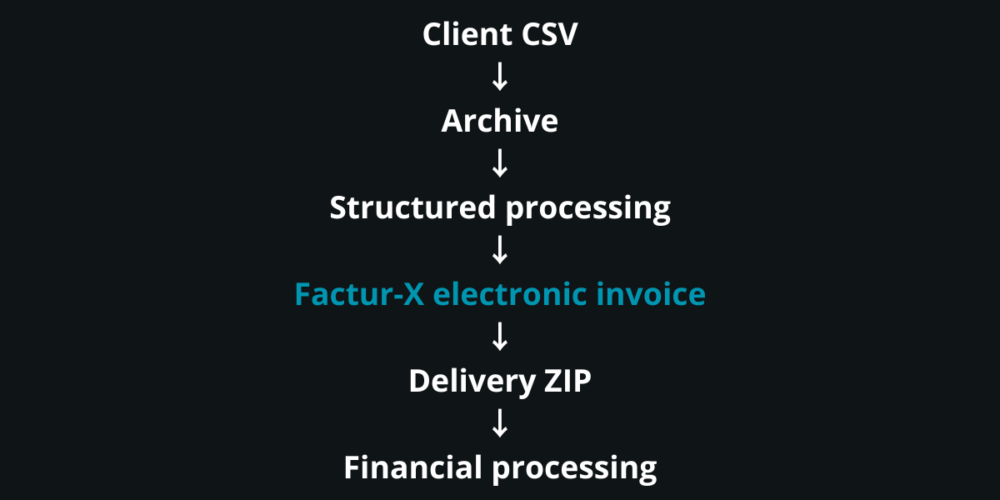

<p align="center">
  
</p>

> 🇬🇧 English | [🇫🇷 Français](./README_FR.md)


[](https://www.youtube.com/@Palks_Studio)
[](https://www.linkedin.com/in/palks-studio/)
[](https://dev.to/palks_studio/building-a-factur-x-en16931-engine-from-scratch-what-actually-took-time-2bg2)

<p align="center">
  <a href="https://palks-studio.com">
    
  </a>
</p>


# Palks Studio : Automation System

**Financial automation built for rigor, traceability, and longevity**

> This repository is a technical presentation and documentation repository.  
> It does not contain downloadable source code or production files.

This README documents design principles and system architecture.  
It intentionally avoids operational procedures and sensitive details.

---

## Overview

This repository presents a financial automation system designed to handle:

- the generation of Factur-X electronic invoices (PDF/A-3 with embedded XML), using the Factur-X Comfort profile corresponding to EN 16931, in both direct and batch modes  
- revenue tracking  
- payment reconciliation  
- customer balances  
- accounting-ready exports

The system is deterministic, auditable, and explicit by design.

It operates:

- without a database  
- without a CMS  
- without SaaS dependencies  
- with a web surface limited to strictly necessary entry points

Automated processes run server-side via cron. Payment verification is the only operation performed manually through the CLI. Web interfaces handle the necessary interactions with clients without directly exposing the engine.

This project is not a product, a SaaS, or a turnkey solution.

It documents a rigorous, production-oriented approach to financial automation.

Since its earliest versions, the engine has been progressively enhanced to cover real-world, complex business cases without compromising its original design principles.

Invoice generation produces hybrid Factur-X documents (PDF/A-3 with embedded XML), using the Factur-X Comfort profile corresponding to EN 16931. The pipeline includes XSD and Schematron validation.

The invoicing system handles invoices only, without quotation generation. It supports:

- multi-line invoices  
- invoices with multiple VAT rates  
- extended or split service periods  
- invoicing covering multiple months  
- complex combinations while maintaining compliance with the Factur-X Comfort profile (EN 16931)

These functional enhancements have not altered the deterministic, auditable, and traceable nature of the system.

---

## Technical Retrospective

An article published on DEV Community explores the design of the Factur-X engine and the challenges encountered during its development: data validation, business rules, billing periods, and database-free automation.

[Building a Factur-X / EN16931 engine from scratch: what actually took time](https://dev.to/palks_studio/building-a-factur-x-en16931-engine-from-scratch-what-actually-took-time-2bg2)

---

## Project structure

```
automation-system/
│
├── engine/                           → Core automation engine (billing, generation, processing)
├── data/                             → Internal data storage (clients, invoices, tracking)
├── tools/                            → Internal utilities and maintenance scripts
├── exports/                          → Data export and reporting
├── downloads/                        → Generated document delivery
├── clients/                          → Client configuration
├── contracts/                        → Legal and contractual documents
│
├── LICENCE.md                        → Conditions d’utilisation et cadre légal (FR)
├── LICENSE.md                        → Terms of use and legal Framework
│
├── LICENCE.md                        → Conditions d’utilisation et cadre légal (FR)
├── LICENSE.md                        → Terms of use and legal Framework
│
└── docs/
    ├── README_FR.md                  → Documentation générale du système (FR)
    ├── README.md                     → General system documentation
    │
    ├── SERVICE_MEMO_FR.md            → Note interne de positionnement du service (FR)
    ├── SERVICE_MEMO.md               → Internal Service Positioning Memo
    │
    ├── README_DEPLOY_FR.md           → Guide d’installation et d’exploitation (FR)
    ├── README_DEPLOY_EN.md           → Installation and Production Guide
    │
    ├── VUE_DENSEMBLE_AUTOMATION.md   → Vue d’ensemble du système d’automatisation de facturation (FR)
    └── SYSTEM_OVERVIEW_AUTOMATION.md → Billing Automation System Overview
```

```
web/
├── library/
│   ├── onboarding-client-fr.html         → Génération contrat + configuration client (FR)
│   ├── onboarding-client-en.html         → Contract generation + client configuration (EN)
│   ├── service-agreement-fr.html         → Template de contrat (FR)
│   ├── service-agreement-en.html         → Contract template (EN)
│   ├── import-clients-fr.html            → Formulaire d’envoi CSV client (FR)
│   ├── import-clients-en.html            → Client CSV upload form (EN)
│   └── invoice-layout.html               → Template HTML de facture (FR) / Invoice HTML template (EN)
│
├── contract-builder.php                  → Backend génération PDF (FR) / PDF generation backend (EN)
├── process-import.php                    → Moteur de traitement du formulaire CSV (FR) / CSV upload form processing engine (EN)
│
├── secure_downloads/
│   └── access.php                        → Point d'accès aux téléchargements batch (FR) / Batch download access endpoint (EN)
│
└── temp_tokens/
    ├── activity.log                      → Journal des téléchargements réels (FR) / Download activity log (EN)
    └── secure_tokens.json                → Stockage des tokens de téléchargement (FR) / Download token storage (EN)
```

---

## What This Repository Is (and Is Not)

### This repository is

- a documented financial automation architecture  
- a system designed to be predictable and auditable  
- an example of strict separation between invoicing, payments, and accounting  
- a real system previously used in production

### This repository is not

- certified accounting software  
- a ready-to-use invoicing tool  
- an automated payment system  
- a standalone web application or a public invoicing API

The data produced is designed for internal and operational use, and for seamless integration with standard accounting processes.

---

## Design Principles

The system is built on a set of non-negotiable principles:

- **No magic**  
  Every operation is explicit and traceable.

- **No silent processing**  
  An error stops execution and is logged.

- **No implicit corrections**  
  Invalid data is rejected, never silently corrected.

- **Files are evidence**  
  Generated artifacts are considered immutable.

- **Strict separation of responsibilities**  
  Invoicing, payments, balances, receipts, and exports are independent.

- **Server-side automation**  
  Automated processes are scheduled via cron. Payment verification is performed manually through the CLI. Web entry points remain isolated from the engine.

These choices prioritize predictability over convenience, and clarity over speed.

The progressive enhancement of the engine has not compromised these principles.

Additional features (multi-line invoices, multiple VAT rates, complex billing periods) strictly follow the same rules of predictability, traceability, and explicit rejection.

---

## System Architecture (High-Level Overview)

The system consists of independent layers, each with a single responsibility:

- **Invoicing engines**  
  - direct invoicing  
  - batch invoicing (CSV)

- **Business rules**  
  - centralized pricing logic  
  - single source of truth

- **Alert layer**  
  - blocking vs. informational alerts  
  - explicit execution feedback

- **Payment layer**  
  - manual payment recording  
  - deliberately decoupled from invoicing

- **Balance reconciliation**  
  - comparison of invoiced vs. paid amounts  
  - paid / unpaid status detection

- **Export layer**  
  - accounting-ready CSV files  
  - regenerable at any time

Some layers can evolve independently without modifying others, allowing the system to be extended without system-wide side effects.

---

## Execution Model

The system operates through a closed, reproducible cycle:

1. **Generation phase**  
   Invoices are generated according to explicit rules.

2. **Payment phase**  
   Payments are recorded independently, without automation.

3. **Reconciliation phase**  
   Invoiced amounts are compared with payments received.

4. **Consolidation phase**  
   Customer balances are calculated and updated.

5. **Export phase**  
   Accounting data is generated on demand.

### Invoice Payment Stamping Tool

[Invoice Stamper](https://github.com/Palks-Studio/invoice-stamper), a complementary operational tool independent of the engine, generates paid versions of invoices from the original PDF documents.

This tool:

- accepts a ZIP archive containing invoices
- automatically detects PDF files
- applies an explicit "PAID" stamp with the payment date
- generates a new version of the document
- supports individual and batch processing

This tool does not interact with the invoicing engine itself and never modifies the original invoices.

The stamped documents are not Factur-X invoices. They are considered operational artifacts derived from the issued invoices.

### Client Onboarding Tool

A dedicated component converts data submitted through the onboarding form into an internal client configuration used by the automation system.

During processing:

- generation of a unique client identifier  
- creation of the client configuration  
- preparation of the associated batch configuration  
- initialization of payment tracking  
- archiving of processed onboarding data

This step takes place strictly during the preparation phase and does not interfere with the monthly execution cycle.

The system never infers missing information.

### Client Integration Workflow

The integration of a new client follows a deterministic and traceable sequence:

1. collection and validation of contractual information  
2. generation of contractual documents  
3. creation of onboarding data  
4. generation of a unique client identifier  
5. creation of the associated direct and batch configurations  
6. initialization of operational tracking  
7. assignment of individual, secure access to monthly file submissions  
8. association of subsequent submissions with the client's internal identity

Submission access is not generic.

It is permanently associated with the client's configuration to preserve continuity throughout the operational cycle.

Each step produces or consumes explicit data.

No client identity, configuration, or relationship between components is inferred implicitly.

---

## Batch Invoicing

In batch mode:

- a client provides a CSV file  
- each CSV row corresponds to an invoice line item  
- rows sharing the same invoice number are grouped into a single invoice  
- validation is strict and structural  
- the entire batch stops at the first error  
- raw inputs are archived before processing

This model prioritizes data integrity over partial success.

The invoicing model supports complex cases without modifying the execution cycle:

- multi-line invoices  
- multiple VAT rates within a single invoice  
- extended or split service periods  
- invoicing covering multiple months

These capabilities are integrated without introducing implicit conditional logic or special processing outside the engine.

### Entry Point: Client CSV Submission

The monthly CSV file is submitted by the client through a dedicated upload form, accessible only via an individual secure link provided after contractual validation.

The entry point:

- accepts CSV files only  
- provides a downloadable reference CSV template  
- stores the file in a structured internal storage system  
- enforces a single submission per client and billing period  
- retains the file for strict downstream validation

The submitted CSV is treated as a **raw source of invoicing data** and is never considered a final invoice.

It is then validated and processed exclusively within the batch automation workflow.

---

## Integrity and Safeguards

The system implements:

- duplicate prevention mechanisms  
- annual sequential counters  
- immutable archives  
- explicit execution flags  
- categorized alerts  
- comprehensive logging

A complete halt is considered safer than incomplete processing.

Validation rules remain identical regardless of invoice complexity.

A complex case is handled with the same requirements as a simple one.

---

## Single-Client Mode (Targeted Execution)

Some internal engine scripts support an optional parameter:

`--client=<client_id>`

This mode enables targeted execution for a single client for diagnostic purposes or controlled recovery.

Filtering relies exclusively on the `client_id` generated during onboarding.

This mechanism does not alter:

- duplicate prevention mechanisms  
- execution flags  
- global business logic

It provides an occasional targeting mechanism and does not replace the system's scheduled operation.

---

## Security Posture

- automation engine executed exclusively server-side  
- no direct web exposure of the engine  
- web entry points limited to strictly necessary interfaces  
- separation between public interfaces and internal processing  
- no critical API dependencies  
- sensitive data stored server-side

The web surface is deliberately limited and isolated from internal execution components.

---

## Maintenance and Long-Term Sustainability

The system is designed to:

- be understood without its original author  
- be audited months or years later  
- fail visibly  
- integrate cleanly with standard accounting workflows

This repository documents an engineering approach, not a shortcut.

---

## Project Status

**Status: out of service, technical portfolio project.**

The system was developed and operated in real-world production conditions. It is no longer offered as a service and is no longer used internally. The operational requirements of the French electronic invoicing reform, along with the costs and complexity they would have imposed on clients, led to the discontinuation of its operation.

The project is retained as a major technical achievement in the Palks Studio portfolio. Generating compliant Factur-X documents does not, on its own, cover all the transmission and reporting obligations introduced by the reform.

The system is designed to operate autonomously, with a strong emphasis on rigor, traceability, and long-term maintainability.

---

## Libraries

- mPDF 8.3 (mpdf/mpdf) – generation of Factur-X PDF/A-3 documents (electronic invoices) and PDF/A-1b documents (paid invoices)  
- setasign/fpdi – PDF reading and overlay processing (payment stamping via Invoice Stamper)

---

© Palks Studio — see LICENSE.md  
https://palks-studio.com
